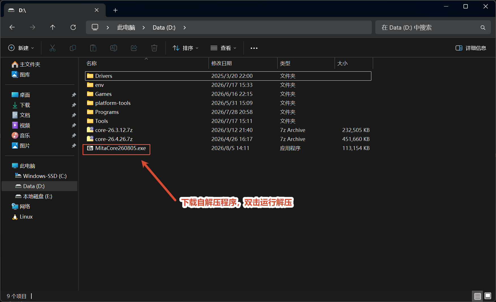
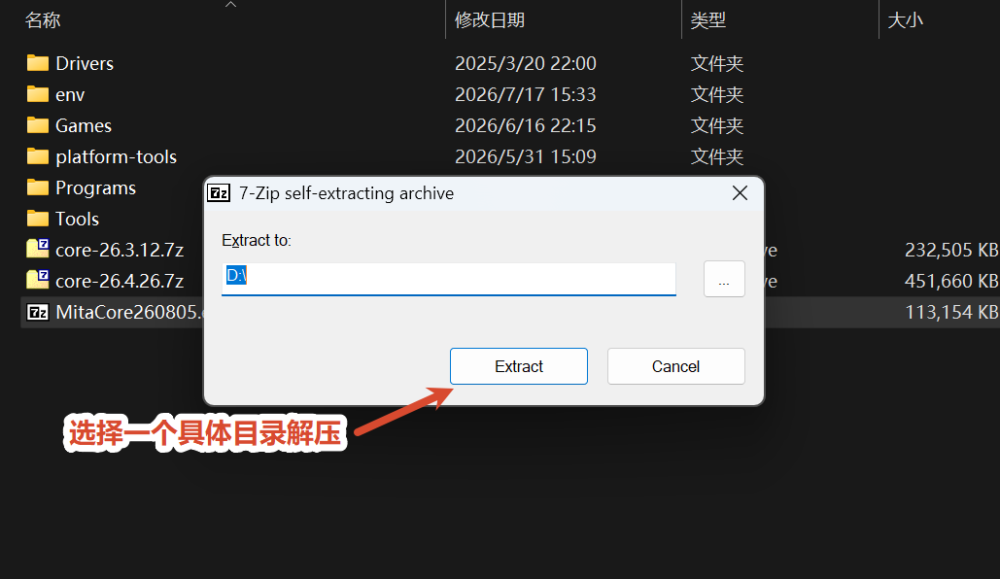
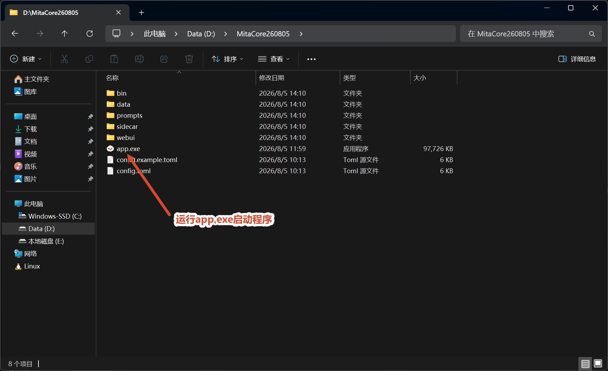
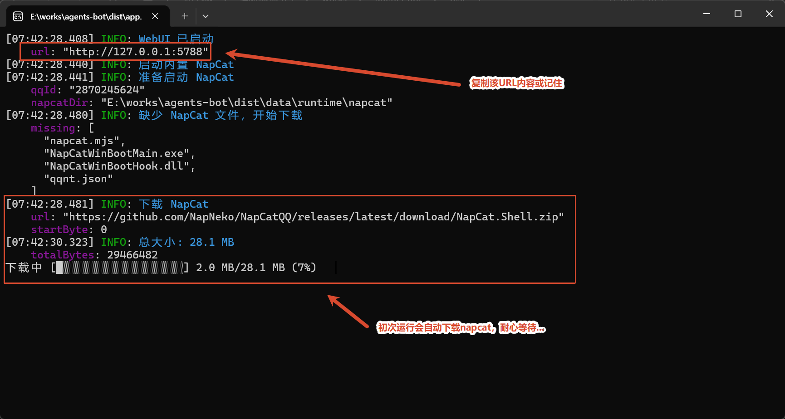
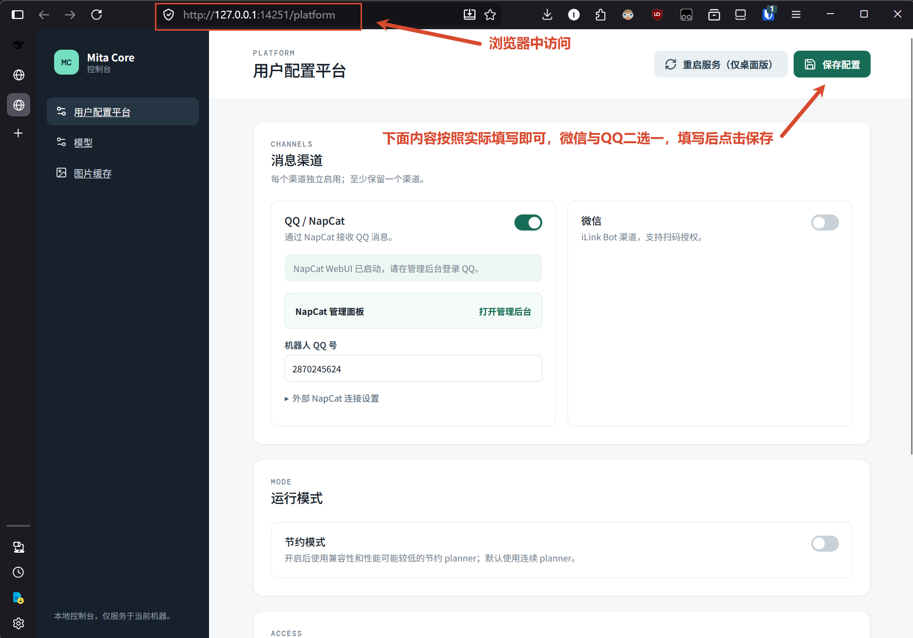
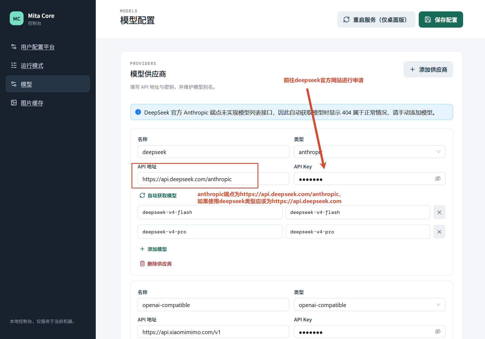
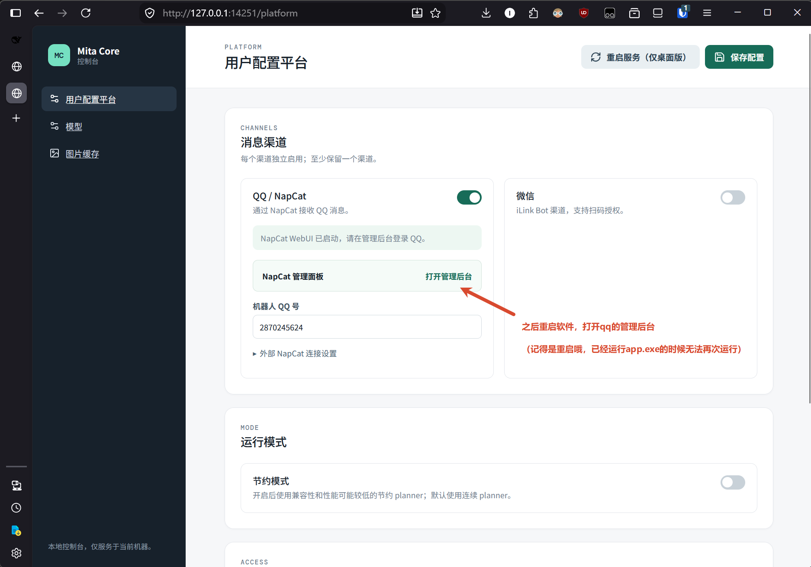
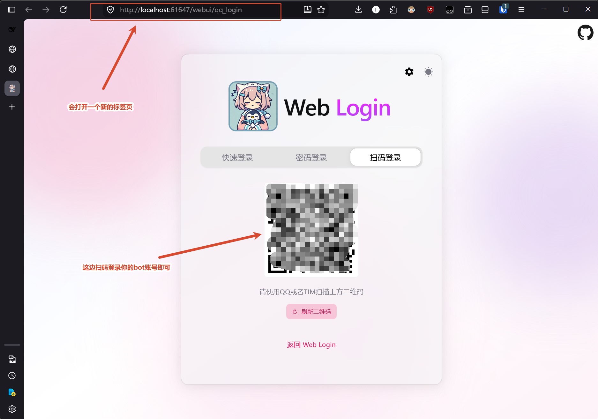
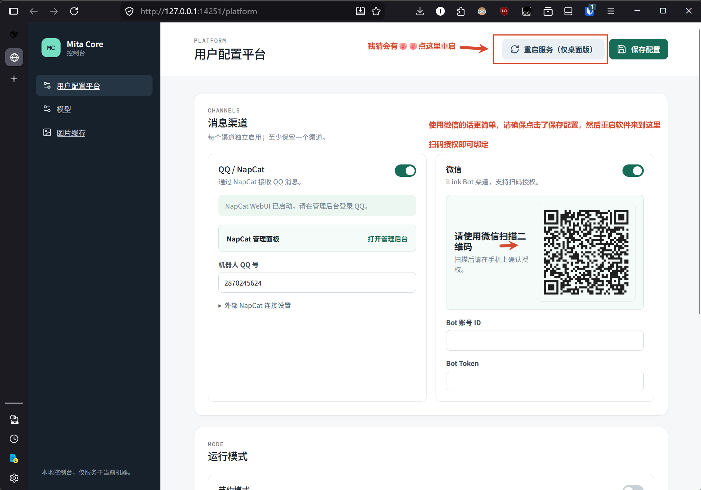

# Mita Core 使用指南

## 使用前准备

- 一份 Mita Core 自解压程序（示例文件名：`MitaCore260805.exe`）。
- 一个可用的模型服务 API Key，例如 DeepSeek 或其他模型服务。
- 如果使用 QQ 渠道，需要准备 QQ 客户端；如果使用微信渠道，需要准备可扫码的微信客户端。

> API Key 属于敏感凭据，请勿把真实 Key 截图、提交到 Git 或发送给他人。

## 快速流程

```text
下载并解压 → 启动 app.exe → 打开 WebUI → 配置消息渠道 → 配置模型 → 保存 → 重启程序
                                      ├→ QQ：打开 NapCat 管理后台并扫码登录
                                      └→ 微信：保存并重启程序后扫码授权
```

## 1. 下载并解压

下载完成后，双击自解压程序。建议将程序解压到一个独立目录，并记住该目录位置。



在解压窗口中选择一个具体的目标目录，然后点击 **Extract（解压）**。



## 2. 启动 Mita Core

进入解压后的目录，确认能看到 `bin`、`data`、`prompts`、`sidecar`、`webui` 等目录，以及 `app.exe`。双击 `app.exe` 启动程序。



程序启动后会在控制台输出 WebUI 地址。复制日志中 **WebUI 已启动** 下方第一行的 `url`，不要复制 NapCat 的地址。



示例地址为 `http://127.0.0.1:14251`，实际端口以当前窗口输出为准。

## 3. 打开 WebUI

在浏览器地址栏粘贴刚才复制的地址并访问。进入后默认打开 **用户配置平台** 页面。



WebUI 只服务于当前电脑。配置完成后不要关闭 `app.exe` 控制台窗口，否则 WebUI 和消息渠道也会停止。

## 4. 配置模型服务

点击左侧 **模型**，进入模型配置页面。添加或修改模型供应商时，填写以下内容：

1. **名称**：自定义的供应商名称，例如 `deepseek`。
2. **类型**：按服务商选择对应类型。DeepSeek 请选择 `anthropic`；不要选择 `openai-compatible`。
3. **API 地址**：填写服务商提供的接口地址。
4. **API Key**：粘贴服务商后台申请的 Key。
5. **模型**：点击 **自动获取模型**，或手动填写服务商支持的模型名称。

配置完成后点击页面右上角的 **保存配置**。



### DeepSeek 配置示例

DeepSeek 的供应商类型请选择 **`anthropic`**，API 地址填写 `https://api.deepseek.com`。该配置使用 Anthropic 端点，比旧版 OpenAI 端点更适合当前程序。请以服务商当前文档为准，不要照抄截图中的脱敏 Key；如果接口要求版本后缀，也要按服务商要求填写。

## 5. 配置 QQ 渠道（NapCat）

回到左侧 **用户配置平台**，确认 **QQ / NapCat** 开关已打开，并填写机器人 QQ 号。

点击 **NapCat 管理面板** 右侧的 **打开管理后台**。这会打开一个新的浏览器标签页。



在新页面中选择 **扫码登录**，使用 QQ 或 TIM 扫描二维码，登录准备作为机器人的 QQ 账号。



登录成功后返回 Mita Core 配置页面，确认机器人 QQ 号与实际登录账号一致。

> 如果 `app.exe` 已经运行，不能重复双击启动。修改 QQ 登录状态时，应先按后文的“重启程序”操作，再重新打开 NapCat 管理后台。

## 6. 配置微信渠道（可选）

如果需要使用微信，在 **用户配置平台** 页面打开 **微信** 开关，然后点击右上角 **保存配置**。不要点击页面上的 **“重启服务（仅桌面版）”**，直接关闭并重新启动 `app.exe`。

程序重新启动后，页面会显示微信授权二维码。使用微信扫描二维码，并在手机上确认授权；授权成功后，填写或确认页面要求的 Bot 账号信息。



微信和 QQ 可以按需选择。未使用的渠道保持关闭即可。

## 7. 保存并重启程序

完成模型、QQ 或微信配置后，按以下顺序操作：

1. 点击右上角 **保存配置**。
2. 关闭 `app.exe`，再从解压目录重新启动它。
3. 等待 `app.exe` 控制台重新输出启动日志。
4. 如使用 QQ，重新打开 NapCat 管理后台确认登录状态；如使用微信，按页面提示完成扫码授权。


## 常见问题

### 浏览器打不开 WebUI

确认 `app.exe` 仍在运行，并使用控制台最新输出的 WebUI `url`。如果程序刚刚重启，旧端口或旧页面可能已经失效。

### 修改配置后没有生效

先点击 **保存配置**，再关闭并重新启动 `app.exe`。仅修改页面内容而不保存，重启后不会保留。

### QQ 管理后台打不开或登录失效

确认 NapCat 相关组件已正常启动，机器人 QQ 号填写正确；如果刚修改过配置，先保存并重启程序，再重新打开管理后台。不要重复启动多个 `app.exe` 实例。

### 模型调用失败

检查 API 地址、API Key、供应商类型和模型名称是否匹配服务商；确认账户余额、模型权限及网络连接正常。配置 DeepSeek 时，优先检查类型是否为 `anthropic`，不要误选旧版 `openai-compatible`。

### 如何停止程序

直接关闭 `app.exe` 对应的控制台窗口即可停止本机服务。下次使用时，从解压目录重新双击 `app.exe`，再访问新的 WebUI 地址。
